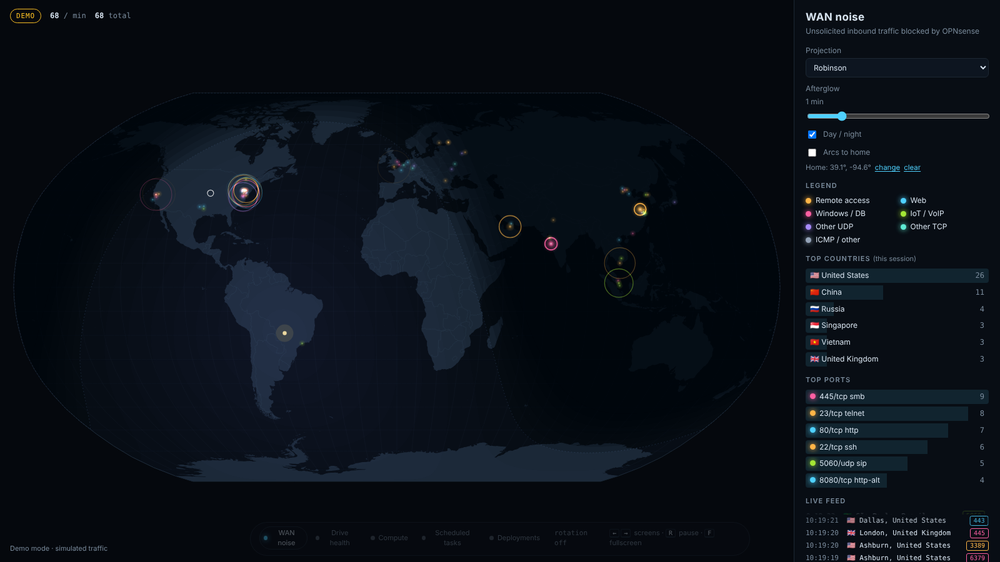
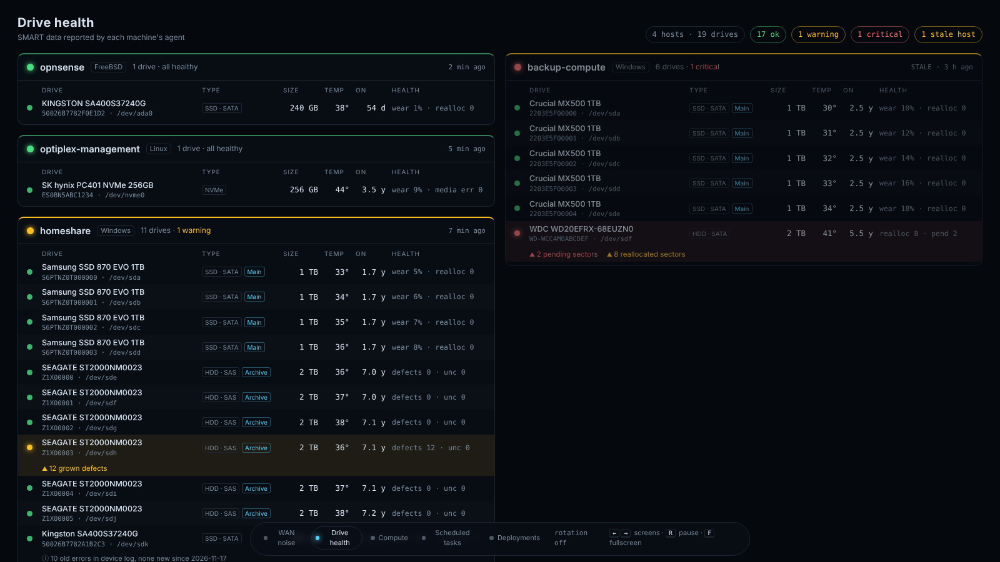
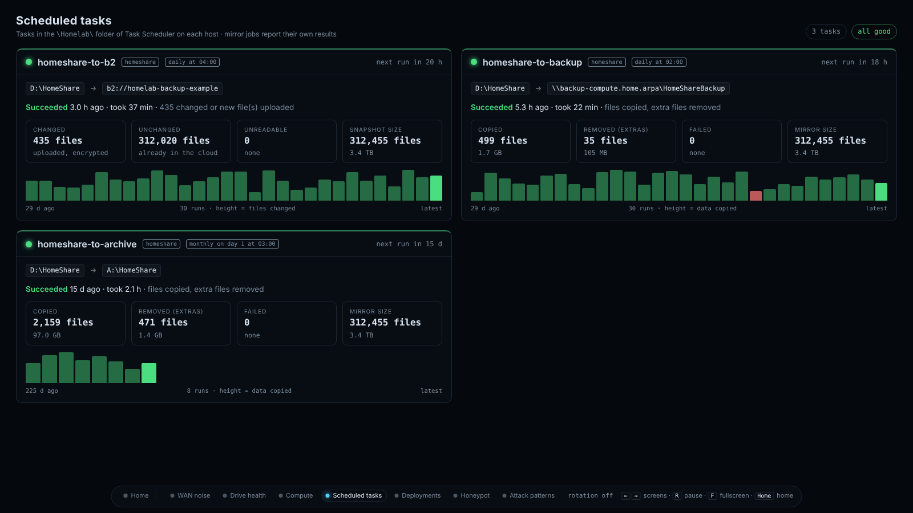
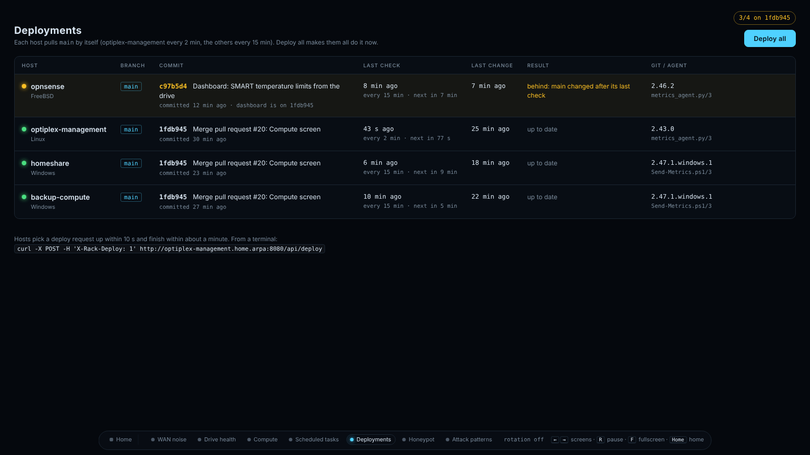
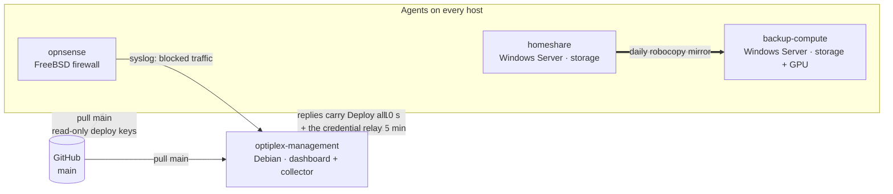

# Homelab: rack dashboard, self-updating agents and managed backups

A rotating **rack dashboard** for my homelab, plus the plumbing that keeps it and four machines current: per-machine agents that report every 10 seconds, a pull-based deploy system where **one button updates every host**, and backup jobs defined in git and applied automatically. It covers a FreeBSD firewall, a Linux management box and two Windows Server storage servers.

[](https://j-will178.github.io/homelab-showcase/)

**[▶ Open the live demo](https://j-will178.github.io/homelab-showcase/)**: the real UI on simulated data, built and published by CI on every push. Use ← → to switch screens, and press *Deploy all* on the Deployments screen.

## What's on the screens

| | |
|---|---|
|  **WAN noise.** Live world map of unsolicited inbound traffic blocked by OPNsense (syslog → GeoIP → SSE), with day/night shading. |  **Drive health.** SMART for every drive in the rack (SATA, SAS behind an HBA, NVMe), with wear, temperature limits read from each drive, and error-log baselines. |
|  **Compute.** CPU with a per-core strip, memory, GPU (including encoder use for Jellyfin), network and disk I/O, top processes, and 1-hour charts, from agents reporting every 10 seconds. |  **Scheduled tasks.** Backup mirror jobs: last result, data copied and removed, failures, 30-run history, and *overdue* measured against each job's schedule. |


**Deployments.** Per-host commit, last check, result and git version, plus **Deploy all** with live per-host progress (shown in the animation above).

## Architecture



Every host **pulls**. Nothing connects into a server except agents posting to the dashboard.

## Design decisions worth a look

**Pull-based deploys, one button.** Each host runs its own updater on a timer: a systemd timer on Linux, a SYSTEM scheduled task on Windows, cron and configd on OPNsense. It fetches `main` with a read-only deploy key and installs only the files it manages. *Deploy all* doesn't push anything. It records a request that the dashboard returns in its replies to the agents' 10-second metrics posts, and each host just brings its normal update forward. The endpoint needs no login, because it can't make a host do anything except update from `main` sooner. It's rate-limited, and requires a custom header so another website can't trigger it through a visitor's browser.
→ [`deploy/homelab-deploy.sh`](deploy/homelab-deploy.sh), [`dashboard/agents/Invoke-RackAgent.ps1`](dashboard/agents/Invoke-RackAgent.ps1)

**Updaters that update themselves correctly.** A script that pulls a new version of itself is still running the *old* code in memory. Both updaters detect this and re-run as the new version once (`exec … --apply` on Linux, `-AfterSelfUpdate` on Windows), so a single update applies everything a commit adds. That bug shipped once: agent units weren't installed because the previous version's script ran the deploy. The fix includes a self-healing check on every run.

**Health-checked rollouts with rollback.** On the dashboard host, a deploy runs the unit tests and a syntax check, restarts the service, and waits for `/api/smart` to answer. On failure it rolls back, and records the bad commit so it isn't retried every 2 minutes. Windows and FreeBSD agents are parse-checked (PowerShell AST, `ast`, `sh -n`) before they replace a working copy.

**Backups defined in git, applied without touching the server.** [`backups/tasks.json`](backups/tasks.json) declares each mirror job: host, source, destination, schedule, time limit. The Windows updater (running as SYSTEM) builds each scheduled task from it and fingerprints it, then re-registers it when the definition changes or someone edits it by hand. Git is the source of truth. It only ever removes tasks it created *for that host name*.
→ [`backups/Sync-MirrorTasks.ps1`](backups/Sync-MirrorTasks.ps1)

**`/MIR` that can't wipe the wrong folder.** A mirror deletes whatever isn't in the source, and paths now come from a commit. So the runner only mirrors into a destination it can prove belongs to the job: a marker file it wrote on the first run and excludes from the mirror, or a new or empty folder, or one that already looks like this mirror, which it adopts once. It also refuses an empty source (an unmounted pool would otherwise empty the backup), overlapping paths, and concurrent runs. It parses robocopy's exit-code *flags* (0–3 ok, 4–7 warn, 8+ failed), so a successful copy isn't reported as a failure the way a plain script is.
→ [`backups/Invoke-Mirror.ps1`](backups/Invoke-Mirror.ps1)

**A share credential nobody types, sees, or stores in plaintext.** The daily mirror writes to another machine's share, and outside a domain SYSTEM can't authenticate there. Instead:
1. The storage server keeps an RSA-3072 key in the Windows machine key store and publishes only the public half.
2. The backup server creates a least-privilege local account with a random password: share and folder write, no interactive or RDP logon. It encrypts the password to that key.
3. The dashboard relays only a public key and ciphertext.
4. The backup server **pins** the first key it sees. A different key, say from another holder of the agent token trying to obtain the password, is refused until a deliberate `key_epoch` bump in git.

→ [`backups/MirrorCredential.ps1`](backups/MirrorCredential.ps1), [`dashboard/creds.py`](dashboard/creds.py)

**Agents built for small, steady load.** One agent per OS: Python (standard library only) on Linux and FreeBSD, PowerShell 5.1 on Windows. Metrics are averaged over each 10-second window. Logging is limited to state changes (first failure, recovery), so logs don't grow every 10 s. History is a fixed in-memory buffer (1 h × 10 s) that can't grow, and times travel as ages so host clocks don't matter.

## Repository map

| Path | What |
|---|---|
| [`dashboard/`](dashboard/) | Collector (Python standard library + optional MaxMind/DB-IP reader), web UI (vanilla JS, d3 for the map), agents, tests, static-demo builder |
| [`deploy/`](deploy/) | Pull-based deploy for the dashboard host: systemd timer, health check, rollback |
| [`backups/`](backups/) | Robocopy mirror runner, task sync from `tasks.json`, share-credential handoff |
| [`docs/topology.md`](docs/topology.md) | The lab: hardware, network, services, backup jobs (Mermaid diagrams) |

Run the dashboard locally on simulated data:
```bash
python3 dashboard/collector.py --demo    # then open http://localhost:8080
```

## About this repo

This is a public export of my private homelab repo. Its `showcase/export.py` copies an allowlist of folders on every merge, and refuses to publish anything that looks like a secret: keys, tokens, public IPs, personal emails or machine names. History starts at the export; the private repo has the full PR-by-PR history. Built with [Claude Code](https://claude.com/claude-code) as a pair programmer: I set direction and constraints and reviewed and ran everything on real hardware; most of the code was written in that pairing.

Exported from commit `a971b1a` · [MIT License](LICENSE)
