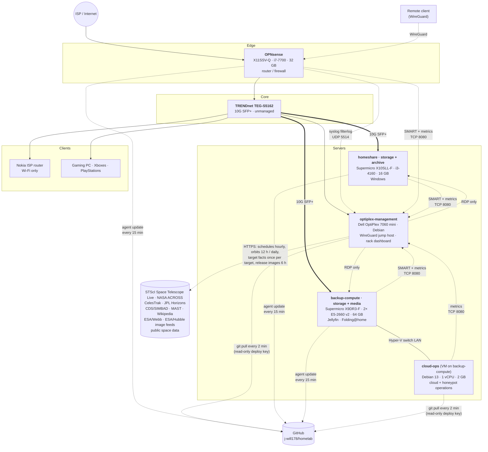
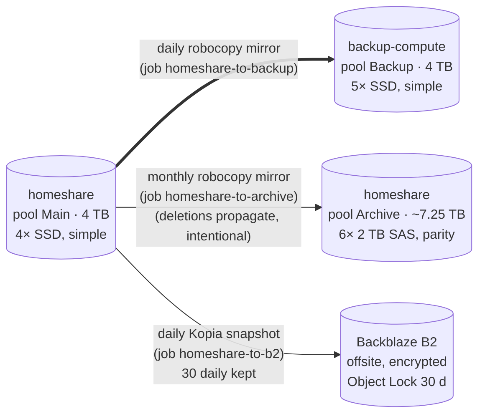

# Lab topology

This is the source of truth for how the lab is laid out. **Update it in the same PR as any change to hardware, network or data flows.**

Diagrams are Mermaid, so GitHub renders them inline and changes show up as readable diffs.

_Last updated: 2026-11-23_

## Hosts

All hosts are in the `home.arpa` DNS domain (served by OPNsense), e.g. `opnsense.home.arpa`.

| Host name | Hardware | OS | Role |
|---|---|---|---|
| `opnsense` | Supermicro X11SSV-Q · i7-7700 · 32 GB | OPNsense | Router / firewall |
| `optiplex-management` | Dell OptiPlex 7060 mini | Debian | WireGuard jump host, rack dashboard, auto-deploy |
| `homeshare` | Supermicro X10SLL-F · i3-4160 · 16 GB | Windows | Main file share (**Main** pool, SSD) + SAS archive (**Archive** pool) |
| `backup-compute` | Supermicro X9DR3-F · 2× E5-2660 v2 · 64 GB | Windows | Mirror of the Main pool (**Backup** pool, SSD), Jellyfin, Folding@home, Hyper-V host for `cloud-ops` |
| `cloud-ops` | Hyper-V VM on backup-compute · 1 vCPU · 2 GB RAM · 25 GB disk | Debian 13 | Cloud and honeypot operations: DigitalOcean token, Terraform state, Packer, weekly honeypot rebuild, honeypot log puller. Built from [`vms/`](../vms/) |

## Network

Notes:
- Flat network: no managed switch yet, so no VLANs.
- The Nokia ISP router sits behind OPNsense (its WAN port on the TRENDnet) and only provides Wi-Fi.
- WireGuard clients land on optiplex-management, which only allows RDP to the storage servers.
- The dashboard's space section (`/space/`, `/api/space`) fetches public data out over HTTPS on a timer, from optiplex-management only, and caches it in `state/space.json`: telescope schedules from STScI's Space Telescope Live (hourly, 4 requests per telescope), with NASA ACROSS as the fallback, Hubble's orbit from CelesTrak (every 12 h) and Webb's position from JPL Horizons (daily). For the info panel, each new target is looked up once (at most 6 per 5 minutes) and cached for good in `state/space-info.json` and `state/space-img/`: CDS Sesame and SIMBAD (what the object is, distance), Wikipedia (a two-sentence summary), MAST (program title and PI, and the image: the telescope's own newest public preview of that spot) and, when there's none, a DSS2 survey cutout from NASA SkyView or STScI's DSS server. The CDS (Strasbourg) hosts time out from this network, so those parts are usually missing; each part is independent, so the rest still shows. The Space gallery (`/space/gallery/`) checks the ESA/Webb and ESA/Hubble image feeds every 6 hours and keeps the newest 16 release images in `state/space-gallery/`. Browsers never call those sites.
- optiplex-management auto-deploys from `main` (see [`deploy/`](../deploy/)): a systemd timer pulls the repo and redeploys the rack dashboard to `/opt/rack-dashboard` when it changes. Outbound only.
- Agents on every machine push **compute metrics every 10 seconds** and **drive health (SMART) every 15 min** to optiplex-management (token-authenticated). It still only connects out to the servers over RDP.
- Backup share credential: homeshare publishes a public key and backup-compute posts the `svc-backup` password encrypted to it via `/api/creds` on the dashboard (agent token; the dashboard never sees the password).
- **Deploy all** (`POST /api/deploy`, button on the Deployments screen) travels back to the hosts in the replies to those metrics posts; each host then pulls `main` itself. No inbound connections to the hosts are added.
- cloud-ops is a Hyper-V VM on backup-compute, bridged to the LAN through the virtual switch `LAN` (DHCP reservation for MAC `02:4C:41:42:00:01`). It is built from git by backup-compute's agent (see [`vms/`](../vms/)) and deploys itself like optiplex-management (`homelab-deploy`, role `cloud-ops`). Its nftables firewall allows SSH in from the LAN only; out: DNS, DHCP, NTP, HTTP(S) (Debian, DigitalOcean API, HashiCorp releases, GitHub), SSH (GitHub; Packer's build droplet), TCP 2222 (honeypot bastion) and TCP 8080 to the dashboard. On first boot it posts its public deploy key to the dashboard (`/api/deploykeys`, agent token) until it's added on GitHub.
- opnsense, homeshare and backup-compute update their agents themselves: before each run they pull `main` over SSH (TCP 22) with a per-machine **read-only** deploy key. Outbound only. Nothing pushes to them.

## Services

| Host | Service | Port | Deployed by |
|---|---|---|---|
| optiplex-management | `rack-dashboard`: sections `/home/`, `/rack/`, `/space/`, `/space/gallery/` (noise map, drive health, compute, tasks, deployments, honeypot and attack patterns (simulated until cloud-ops posts the first real events, then real for good: 30 days in `honeypot.db`); replaced `noise-map`) | UDP 5514 in (syslog from OPNsense), TCP 8080 in (web + SMART/metrics reports from LAN); HTTPS out for the space section (spacetelescopelive.org hourly, api.across.sciencecloud.nasa.gov as its fallback, celestrak.org every 12 h, ssd.jpl.nasa.gov daily; target facts once per new target from mast.stsci.edu, skyview.gsfc.nasa.gov, archive.stsci.edu, en.wikipedia.org, and cds.unistra.fr / simbad.cds.unistra.fr / alasky.cds.unistra.fr, which time out from this network as of 2026-11-22; gallery release images every 6 h from esawebb.org, esahubble.org, cdn.esawebb.org, cdn.esahubble.org, with feeds.feedburner.com as the feed mirror) | `homelab-deploy.timer` |
| optiplex-management | `rack-metrics-agent.service` (10 s loop) + `rack-smart-agent.timer` (15 min) | → 127.0.0.1:8080 | `homelab-deploy.timer` |
| homeshare, backup-compute | Scheduled task *Rack Dashboard SMART agent* (`Invoke-RackAgent.ps1`, every minute: keeps task *Rack Dashboard metrics* running, a 10 s loop; every 15 min: update + SMART) | → optiplex-management:8080, → github.com:22 | self-updating (one-time `Install-SmartAgent.ps1 -AutoUpdate`) |
| OPNsense | configd action `rackagent smart-push` (`run.sh`) + GUI cron **every minute** (keeps the 10 s metrics loop running under `daemon -r`; update + SMART every 15 min) | → optiplex-management:8080, → github.com:22 | self-updating (one-time `install-opnsense.sh`) |
| optiplex-management | `homelab-deploy.timer` | outbound SSH to GitHub | manual (one-time) |
| optiplex-management | WireGuard | — | manual |
| backup-compute | Jellyfin | — | manual |
| backup-compute | Hyper-V VM `cloud-ops` (created by `Sync-HyperV.ps1`, run by the agent; never changed or deleted automatically) | — | `vms/vms.json` (one-time: Hyper-V + switch `LAN`) |
| cloud-ops | `rack-metrics-agent.service` (10 s loop), nftables, unattended-upgrades (reboot 04:45 if needed) | → optiplex-management:8080 | `homelab-deploy.timer` (role `cloud-ops`) |
| cloud-ops | `homelab-deploy.timer` (first set up by `homelab-bootstrap` on first boot) | outbound SSH to GitHub | `vms/cloud-ops.user-data` |
| cloud-ops | `hp-pull.service` (honeypot log puller, unprivileged system user `hp-pull`, every 30 s) | → bastion:2222 → honeypot:47022 (SSH), → optiplex-management:8080 `/api/honeypot/ingest` | `homelab-deploy.timer` |
| cloud-ops | `hp-rebuild.timer` (weekly: Packer image + `terraform apply`), `hp-refresh.timer` (daily `terraform apply`); Terraform + Packer, signature-verified | → api.digitalocean.com:443, → releases.hashicorp.com / registry.terraform.io / GitHub:443, → Packer build droplet:22 | `homelab-deploy.timer` (one-time: `sudo hp-secrets`) |

## Data and backups

| Job | Runs on | Source → destination | Schedule | Reported on |
|---|---|---|---|---|
| `homeshare-to-backup` | homeshare, task `\Homelab\Mirror homeshare-to-backup` (SYSTEM; writes as `svc-backup` on backup-compute, credential exchanged automatically via the dashboard) | Main pool → `\\backup-compute.home.arpa\HomeShareBackup` (Backup pool), SMB over 10G | daily | dashboard *Scheduled tasks* |
| `homeshare-to-archive` | homeshare, task `\Homelab\Mirror homeshare-to-archive` (SYSTEM, defined in `backups/tasks.json`) | Main pool → Archive pool (`A:`) | monthly | dashboard *Scheduled tasks* |
| `homeshare-to-b2` | homeshare, task `\Homelab\Cloud backup homeshare-to-b2` (SYSTEM; Kopia, encrypted on homeshare before upload) | Main pool (**currently only `D:\HomeShare\School`, as a test**) → Backblaze B2 bucket over its S3 API (HTTPS 443 out through opnsense); 30 daily snapshots, each locked against deletion for 30 days (Object Lock, compliance mode) | daily | dashboard *Scheduled tasks* |

Managed jobs are defined entirely in `backups/tasks.json` (paths, schedule) and created/updated by the homeshare updater on every update / Deploy all; mirror jobs run `backups/Invoke-Mirror.ps1`, which only mirrors into a destination marked as that job's (logs and the last 30 results in `%ProgramData%\HomelabBackups`). One-way: homeshare is always the source.

The cloud job runs `backups/Invoke-CloudBackup.ps1` with a Kopia version pinned (and SHA-256 checked) in `backups/kopia.json`. Its B2 key and repository password are stored only on homeshare, encrypted to its machine key (one-time `Set-CloudBackupSecrets.ps1`); the repository password is also kept in the password manager, since without it the cloud copy can't be decrypted.

## Rack (bottom → top)

| Position | Device | Notes |
|---|---|---|
| 1 | homeshare (RackChoice 4U) | Storage + SAS archive |
| 2 | backup-compute (SilverStone RM42-502 4U) | Storage + Jellyfin |
| 3 | Tripp Lite 1200 W UPS | Feeds the PDU |
| 4 | StarTech 8-outlet PDU | Everything plugs in here |
| 5 | Shelf | OPNsense (left) · optiplex-management (Dell OptiPlex, right) · TRENDnet switch (no longer on top of the OptiPlex) |

About 4U free.

## Power

All gear → StarTech PDU → Tripp Lite 1200 W UPS.

Planned:
- UPS power signaling for graceful shutdown.

## Open items

- [ ] Kopia cloud backup: enabled; run the one-time secrets script on homeshare, then test a restore after the first upload
- [x] Cloud honeypot, **live** since 2026-11-19 (DigitalOcean TOR1, code in [`honeypot/`](../honeypot/), lab side on cloud-ops; mode `public`): Cowrie VM with no outbound access, rebuilt weekly from a Packer image by Terraform on cloud-ops; reached only through a bastion (inbound SSH from the home IP only); logs and a minimal health snapshot pulled by cloud-ops into the dashboard's Honeypot screen. Network paths:

  | From | To | Port | Allowed by |
  |---|---|---|---|
  | cloud-ops (home IP) | bastion reserved IP | TCP 2222 | bastion cloud firewall |
  | bastion | honeypot | TCP 47022 | honeypot cloud firewall (bastion tag only) |
  | internet (home IP only in modes `lab-debug` and `lab`; anyone in `public`, now) | honeypot | TCP 22, 23 (Cowrie) | honeypot cloud firewall |
  | honeypot | anywhere | none | no outbound rules |
  | cloud-ops (home IP) | Packer build droplet (during a weekly build only) | TCP 22 | `hp-build` cloud firewall (home IP only) |
- [ ] UPS graceful shutdown
- [ ] Managed switch + VLANs
- [ ] GPU for Jellyfin transcoding / local AI (homeshare or a separate box)
