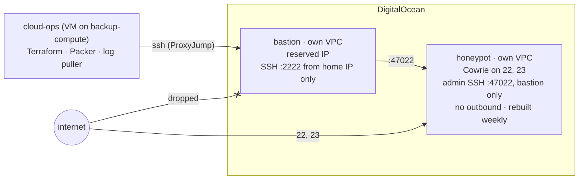

# honeypot: Cowrie SSH/Telnet honeypot on DigitalOcean

A disposable Cowrie honeypot in the cloud, reached only through a bastion, with no outbound access. Its logs feed the dashboard's **Honeypot** and **Attack patterns** screens (simulated until this is running).

> **Status:** **live** since 2026-11-19 (mode **`public`**): Cowrie is reachable from the internet. The `lab-debug` checklist and the `lab` dress rehearsal below passed first. The lab side is on [cloud-ops](../cloud-ops/) (verified Terraform/Packer, weekly rebuild, log puller); it creates the droplets once you run `hp-secrets` there.

## Contents

| Path | What |
|---|---|
| `packer/honeypot.pkr.hcl` | Builds the honeypot image on a short-lived droplet (which has internet access): patched Debian 13, Cowrie, hardening |
| `packer/scripts/build.sh` | The image build itself; leaves no host keys, authorized keys or build traces behind |
| `packer/files/requirements.txt` | Cowrie **3.1.7** and every dependency, pinned to exact versions **and SHA-256** (`pip --require-hashes`) |
| `packer/files/cowrie.cfg`, `userdb.txt` | Cowrie config: SSH + Telnet, JSON log only. Default user db: root gets in with any password except `root` and `123456` |
| `packer/files/cowrie.service` | Cowrie as an unprivileged, sandboxed systemd service (no capabilities, read-only system, syscall filter) |
| `packer/files/50-honeypot-sshd.conf` | The real sshd on **47022**, keys only. User `collector` is forced to run `hp-log-read` and nothing else |
| `packer/files/nftables.conf` | Host firewall: redirects 22→2222 and 23→2223 for Cowrie, 47022 from the bastion only, **all new outbound dropped and logged** |
| `packer/files/hp-log-read` | Serves Cowrie's JSON log in chunks to the lab (`read`, `read INODE OFFSET`, `status`), across daily rotation |
| `terraform/` | VPCs, both droplets, the bastion's reserved IP, the cloud firewalls, first-boot config (cloud-init) |

## Security model

| Layer | Bastion | Honeypot |
|---|---|---|
| **Cloud firewall** (DigitalOcean, outside the VM; root on the VM can't change it) | In: 2222 from home IP. Out: 47022 to honeypot, DNS, NTP, HTTP(S) for updates | In: 22, 23 from anywhere; 47022 from the bastion only. **Out: nothing** |
| **nftables** (on the VM, second layer + logging) | Same ports, drops logged | Same, plus 22→2222 / 23→2223 redirect; outbound drops logged |
| **sshd** | `jump`: no shell, may only forward to `*:47022`. `hpadmin`: you | `collector`: forced to `hp-log-read`. `hpadmin`: you. Port 47022, keys only, no root |
| **Network** | Own VPC | Own VPC (no private path to the bastion) |
| **Lifetime** | Long-lived, unattended-upgrades | Replaced weekly from a fresh image; nothing persists |

**Why these choices:**
- **No outbound access.** A compromised honeypot can't attack anyone, fetch malware or reach home. Attackers' `wget`s are logged as attempts.
- **Lab pulls.** The honeypot holds no credentials and nothing on it leads anywhere.
- **Host keys generated in the lab and injected.** The lab can pin each new honeypot's identity, so a rebuild doesn't mean trusting a new key blindly. The key is readable from the VM's metadata, but it's only that disposable VM's identity.
- **Home IP never in git.** It's a Terraform variable, looked up when Terraform runs.
- **Reserved IP vs droplet IP.** The bastion's reserved IP is for the lab's inbound connections. The honeypot allows the bastion's droplet IP, because DigitalOcean sends outbound traffic from that address.

## Going live: test first, then open up

`mode` in `terraform/variables.tf` is the honeypot's stage:

| Mode | Who can reach Cowrie (22/23) | Health snapshot pulled with the log | For |
|---|---|---|---|
| **`lab-debug`** | home IP only | full diagnostics: Cowrie's service log, errors since boot, cloud-init, nftables ruleset, listening sockets, failed units | building, breaking and fixing the pipeline |
| **`lab`** | home IP only | the same minimal facts as production | the dress rehearsal: exactly what will run live, only you can reach it |
| **`public`** (now) | anyone | minimal: Cowrie up/down and restarts, ports listening, 22/23 redirects, nftables, cloud-init, failed units, disk | the real thing |

The minimal facts stay in every mode so a dead Cowrie raises a chip instead of looking like a quiet day. The snapshot is written by root on the honeypot every minute (`hp-health`) and read by the collector key (`hp-log-read health`): the collector gets no new access, and nothing leaves the honeypot on its own. The Honeypot screen shows the mode and health as chips; **D** (or clicking a health chip) opens the diagnostics view, which also shows the last lines of a failed rebuild.

Changing stage, forwards or back, is a **one-line PR** changing that default. Deploy all applies it right away, and it **replaces the honeypot**, because the mode is set at its first boot.

**Checklist in `lab-debug`:**

| # | Check | Expected |
|---|---|---|
| 1 | From the laptop, `ssh root@<honeypot>` on 22: two wrong passwords, then any other password; run `uname -a`, a `wget`, an `echo … >> .ssh/authorized_keys` | `123456`/`root` refused, others accepted, fake shell works |
| 2 | On the honeypot (as `hpadmin` through the bastion: `ssh -J hpadmin@<bastion>:2222 -p 47022 hpadmin@<honeypot>`): `tail -f /var/lib/cowrie/log/cowrie.json` | each event within a second |
| 3 | On cloud-ops: `sudo hp-pull ssh hp-honeypot read` | the same lines (proves jump user, forced command, pinned host keys) |
| 4 | Dashboard, Honeypot screen | "simulated" label gone; the session, its summary and tags, the blocked download, within about one pull interval. Note the delay |
| 5 | From **outside** the home network (phone hotspot): honeypot 22, 23, 47022 and bastion 2222 | all **time out** (dropped by the cloud firewall), none refused |
| 6 | On the honeypot as `hpadmin`: `curl https://example.com`, then `journalctl -k \| grep hp-drop-out` | curl fails; the drop is logged. The `wget` from step 1 is a failed download in Cowrie's log |
| 7 | `ssh jump@<bastion>` with a shell, or forwarding to a port other than 47022 | no shell; forward refused |

**Then `mode = "lab"`:** repeat 1–4. Same results, with the diagnostics view showing only the minimal facts.

**Go-live PR:** `mode = "public"`, plus a one-time reset of the dashboard's honeypot history, so the test sessions (and the home IP on the map) don't stay in the 30-day data.

**History reset:** `dashboard/honeypot-reset` holds a token. When it changes in git, the dashboard wipes its stored honeypot history once on the next start, and records the token so restarts don't wipe again. The live feed stays live: the screen goes empty, not simulated. To reset again later (e.g. after testing in a lab mode), put a new token there.

## How a rebuild works

**Region:** `settings.env` (`REGION=tor1`), passed to both Packer and Terraform. It must offer both droplet sizes; on 2026-11-18 only blr1, fra1, lon1, sfo2 and tor1 did (no New York region). Changing it rebuilds everything there on the next Deploy all.

Automated on cloud-ops by [`hp-rebuild`](../cloud-ops/honeypot/hp-rebuild) (weekly, plus a daily `--refresh`):

1. Looks up the home IP (two services must agree) and stages this folder's code into `/var/lib/honeypot`.
2. `terraform apply` of the `hp-build` tag and firewall first, so Packer's build droplet is covered from boot.
3. `packer build`: snapshot `hp-honeypot-<stamp>`.
4. A new honeypot host key, then `terraform plan`. Only the honeypot is replaced (new image, new key), and the firewalls follow the home IP.
5. If the plan deletes the honeypot, the puller is stopped first: stopping it pulls the old honeypot's log one last time. Then `terraform apply` deletes the old honeypot **before** creating the new one, so it's offline for a minute or two.
6. Publishes the addresses and pinned host keys for the puller, deletes snapshots older than the last two.

**Droplet limit:** the account allows 3 droplets. Deleting before creating keeps a rebuild at 2 at most, plus Packer's build droplet earlier in the run. Before Packer runs, and before every apply, the plan is checked against the limit. If it doesn't fit, the rebuild stops before changing anything and names the droplets in use, for example a leftover one to delete.

**Back-to-back merges:** a merge deployed while a rebuild runs leaves a request (`/var/lib/honeypot/request-full` or `request-refresh`). The running rebuild picks it up when it ends and runs again with the newly installed code, so nothing is silently skipped.

**Taking it down:** `sudo hp-rebuild --destroy` on cloud-ops deletes everything on DigitalOcean (the Packer images stay) and pauses: the timers and merges do nothing, and the dashboard says *paused*. `sudo hp-rebuild --resume` builds it again. The bastion then gets a new reserved IP.

`--refresh` skips 2–4's image and key steps: just `terraform apply` with the current image.

## First-time setup (once)

1. **DigitalOcean account:** 2FA on, recovery codes in Bitwarden. The support ticket confirming a no-egress honeypot is fine is already done; keep the reply.
2. **API token:** a custom-scoped token, stored only on cloud-ops by `sudo hp-secrets` (one-time secret, like the backup keys). It needs create/read/update/delete for droplets, firewalls, VPCs, reserved IPs, SSH keys, tags and snapshots/images, plus the read access the provider needs (regions, sizes, actions). Give it an expiry and put a renewal reminder in Bitwarden.
3. **Keys:** the lab key is generated on cloud-ops. Your admin key (`hpadmin`) is your own public key, given to `hp-secrets`.

## Updating Cowrie

Change the version, regenerate `packer/files/requirements.txt` with the SHA-256 of every file PyPI publishes for each pinned version, check that it installs with `pip install --require-hashes`, and merge. The next weekly build uses it.

## Cost

About $10–11/month: bastion `s-1vcpu-512mb-10gb` (~$4), honeypot `s-1vcpu-1gb` (~$6), and the current snapshot (cents). The reserved IP is free while assigned.

## Tested so far (without DigitalOcean)

- Cowrie 3.1.7 installed from `requirements.txt` with hashes enforced, run with this config, and attacked:
  - logins refused and accepted per the user db;
  - recon, a download and SSH key persistence in a shell.
- Its real JSON log went through the dashboard's parser: every event type used was parsed, and the session summary was correct.
- `hp-log-read`:
  - chunked reads, resume and daily rotation (every line exactly once, in order);
  - unknown inode restarts at the oldest file;
  - anything but its three commands is refused.
- **Syntax checks:**
  - `nft -c` on both firewalls;
  - `sshd -t`/`-T` on both sshd configs, with the effective settings for `collector` and `jump` checked;
  - both cloud-init templates rendered and parsed as YAML;
  - HCL parsed.
- Not yet run against the real tools: `hp-rebuild` runs `terraform validate` and `packer validate` on cloud-ops before every build, so a problem there stops the first build before anything is created.
